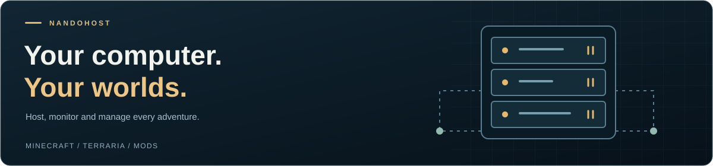

<p align="center"><a href="README.md">Português (Brasil)</a> · <strong>English</strong></p>

<p align="center"></p>

<h1 align="center">NandoHost</h1>

<p align="center"><strong>Your computer. Your worlds.</strong></p>
<p align="center">Minecraft and Terraria servers in a native Windows application.</p>

<p align="center">
  
  
  
  
</p>

<p align="center">
  <a href="#getting-started"><strong>Get started</strong></a> ·
  <a href="#features">Features</a> ·
  <a href="#interface">Interface</a> ·
  <a href="#building">Build</a> ·
  <a href="#verification">Verification</a> ·
  <a href="docs/STATUS.md">Next steps</a>
</p>



**NandoHost** brings installation, console access, mods, process metrics and backups together so you can host games on your own computer. You can play while the server is running, within your machine's available resources.

**In development · version 0.8.9 · private repository.** The presentation follows the app's deep blue and gold palette and its game landscapes.

## Features

| Area | Available functionality |
| --- | --- |
| Minecraft | Java, Bedrock and shared Java + Bedrock worlds with Geyser/Floodgate. |
| Modpacks | Vanilla/Fabric and compatible Modrinth and CurseForge server pack imports. |
| Terraria | Dedicated PC servers, world configuration and native console. |
| tModLoader | Separate Calamity and custom mod profiles with `.tmod` imports. |
| Management | Command suggestions, process metrics, backups and folder shortcuts. |
| Remote access | Prototype playit agent management for players on other networks. |

Worlds stay on your computer. Internet access depends on your network configuration or tunnel provider. The application does not purchase subscriptions or provide cloud hosting. Friends lists, accounts and social chat remain outside the current scope.

Java requires a compatible Java installation. Forge, NeoForge and Quilt are blocked in unsupported flows. CurseForge requires a compatible server pack; the application cannot automatically download every catalog modpack. Calamity requires the user to import compatible Calamity Mod, Calamity Mod Music and dependencies. Clients and servers need compatible versions and mods.

See [project status](docs/STATUS.md) for details and limitations. The supporting technical guides are currently in Portuguese.

## Interface

The library includes a selected-game spotlight, interactive covers, search and shortcuts to existing servers. Each game retains its own colors, typefaces and scenery. Short animations respect the Windows animation preference.


| Terraria | Calamity |
| :---: | :---: |
|  |  |

## Getting started

1. Obtain the **complete compiled package** from the project maintainer or build it with `scripts/Package.ps1`. GitHub's source ZIP does not contain the compiled app.
2. Extract the package and open `app/NandoHost.exe`.
3. Select Minecraft or Terraria in the library and open its servers.
4. In **Configurações**, choose the edition or version and prepare the server. Read and accept the Minecraft EULA where applicable.
5. Start the server and follow the console. Configure a compatible mod profile before creating a modded world.
6. For players outside your network, configure **Conexão externa** and share the correct address and port.

The app requires Windows and .NET Desktop Runtime 10. Minecraft Java may require a compatible Java installation. Leave room for worlds, backups and downloads. The app interface is currently in Portuguese; this English README does not imply an English UI.

The app creates **`Data` next to its executable**. To update, close the application and copy the previous `Data` folder into the new package's `app/Data`. Keep a backup and do not run two copies against the same data.

## Building

Requirements: Windows, PowerShell and the stable .NET 10 SDK. `global.json` selects the SDK and permits feature updates within major version 10. This version has no external NuGet package dependencies.

From the repository root:

```powershell
.\scripts\Build.ps1
```

Output: `artifacts/app/NandoHost.exe`.

To run during development:

```powershell
dotnet restore NandoHost.slnx --configfile NuGet.Config -m:1
dotnet run --project src/NandoHost.App
```

To build a distribution:

```powershell
.\scripts\Package.ps1
```

Output: `dist/NandoHost-0.8.9-Windows.zip`. Packaging uses a fresh staging folder and does not include worlds, credentials or `Data`.

## Verification

During the initial **0.8.9** repository setup, **all 56 standard core checks passed**. Compilation, packaging, library navigation and window resizing were also checked in the reorganized project.

```powershell
.\scripts\Test.ps1
```

This is a recorded validation result, not a live CI status. Standard tests use temporary data and simulated processes. They do not run real game servers or a public tunnel. A full Calamity session still needs validation.

- [Initial setup report](docs/validation/INITIAL-SETUP.md)
- [Tests and UI previews](docs/TESTING.md)
- [Known limitations and next steps](docs/STATUS.md)

## Project structure

| Directory | Contents |
| --- | --- |
| `src/NandoHost.App` | WPF interface, themes and visual assets |
| `src/NandoHost.Core` | Installers, processes, networking, mods, storage and backups |
| `tests/NandoHost.Tests` | Core checks and simulated processes |
| `scripts` | Build, test and packaging scripts |
| `docs` | Architecture, status, validation and images |
| `licenses` | Third-party license texts and provenance |

`artifacts` and `dist` are local outputs ignored by Git. Worlds, backups, downloaded mods and credentials are also excluded.

## Development and credits

The next focus is clean Windows installation and upgrade testing, more real-game and mod testing, and performance, accessibility and security review. See [CONTRIBUTING.md](CONTRIBUTING.md), [architecture](docs/ARCHITECTURE.md), [security](SECURITY.md) and [third-party notices](THIRD_PARTY_NOTICES.md).

The repository remains **private**. No public source license has been assigned at this stage. Third-party licenses remain applicable. No publishing workflows or paid services are configured here.

NandoHost is an independent project and is not an official product of the games or services mentioned.

---

<p align="center">NandoHost · Host on your PC. Continue your journey.</p>
