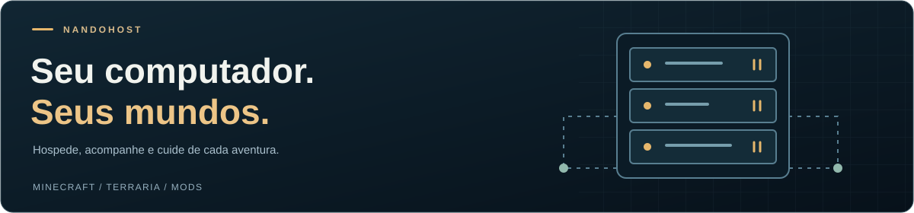
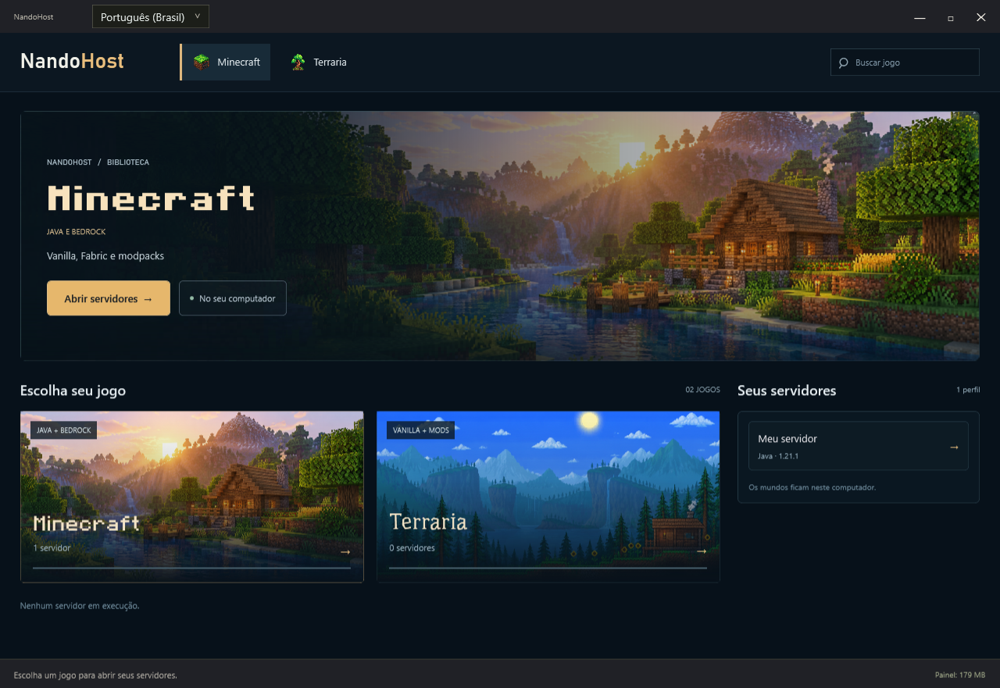
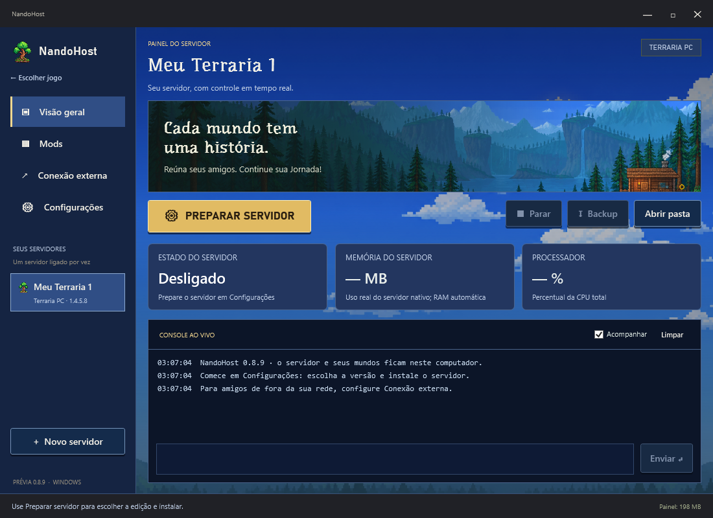
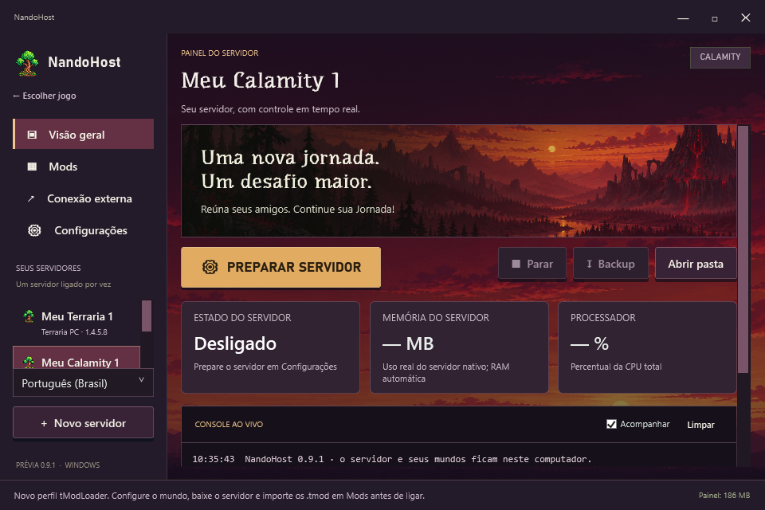

<p align="center"><strong>Português (Brasil)</strong> · <a href="README.en.md">English</a></p>

<p align="center"></p>

<h1 align="center">NandoHost</h1>

<p align="center"><strong>Seu computador. Seus mundos.</strong></p>
<p align="center">Servidores de Minecraft e Terraria em um painel nativo para Windows.</p>

<p align="center">
  <a href="https://github.com/sponsors/Fe-Aoki"></a>
</p>
<p align="center"><sub>Apoio voluntário ao desenvolvimento do NandoHost.</sub></p>

<p align="center">
  
  
  
  
</p>

<p align="center">
  <a href="#como-usar"><strong>Começar</strong></a> ·
  <a href="#recursos">Recursos</a> ·
  <a href="#interface">Interface</a> ·
  <a href="#compilar">Compilar</a> ·
  <a href="#verificação">Verificação</a> ·
  <a href="docs/STATUS.md">Próximos passos</a>
</p>



O **NandoHost** reúne instalação, console, mods, métricas e backups para hospedar jogos no seu próprio computador. Você pode jogar enquanto o servidor está ligado, respeitando os recursos disponíveis na máquina.

**Projeto em desenvolvimento · versão 0.9.1 · repositório público.** A apresentação acompanha a identidade do aplicativo: azul profundo, dourado e as paisagens dos seus jogos.

## Recursos

- Biblioteca de jogos com busca, atalhos de servidores e interação com o mouse.
- Minecraft Java, Bedrock e Java + Bedrock com Geyser/Floodgate.
- Minecraft Vanilla/Fabric e importação de pacotes compatíveis do Modrinth e CurseForge.
- Terraria para PC e perfis tModLoader, incluindo Calamity e mods personalizados.
- Console com sugestões de comandos, métricas do processo e backups locais.
- Protótipo de gerenciamento do agente playit para acesso externo.

Os mundos e os dados dos servidores ficam no computador do usuário. O painel não é uma hospedagem na nuvem nem uma plataforma social. Os downloads dos servidores dependem das fontes oficiais e da conexão com a internet. Forge, NeoForge, Quilt e alguns formatos de pacotes ainda têm limitações; veja [o estado do projeto](docs/STATUS.md).

## Idiomas

Selecione **Português (Brasil)** ou **English** no cabeçalho da biblioteca ou na lateral dentro do jogo. A mudança não exige reiniciar, fica salva para a próxima abertura e preserva os campos que você está editando. Nomes de servidores e mundos, comandos e logs dos jogos mantêm o conteúdo original.

Veja [como os idiomas funcionam](docs/LOCALIZATION.md).

## Interface

Biblioteca com destaque para o jogo selecionado, capas interativas e atalhos dos seus servidores. Cada jogo mantém suas cores, fontes e paisagens.



| Terraria | Calamity |
| :---: | :---: |
|  |  |

## Como usar

1. Obtenha o **pacote compilado completo** com o responsável pelo projeto ou gere-o com `scripts/Package.ps1`. O ZIP de código-fonte do GitHub não contém o aplicativo compilado.
2. Extraia o pacote e abra `app/NandoHost.exe`.
3. Escolha Minecraft ou Terraria na biblioteca e abra os servidores.
4. Em **Configurações**, escolha a edição ou versão e prepare o servidor. No Minecraft, leia e aceite a EULA quando aplicável.
5. Ligue o servidor e acompanhe o console. Para usar mods, prepare um perfil compatível antes de criar o mundo.
6. Para jogadores fora da sua rede, configure **Conexão externa** e compartilhe o endereço e a porta corretos.

Para atualizar, feche o programa e copie a pasta `Data` anterior para `app/Data` do novo pacote. Guarde um backup e não abra duas cópias usando os mesmos dados.

### Abrir no desenvolvimento

Requisitos: Windows, PowerShell e SDK .NET 10 estável. O SDK foi definido em `global.json`, com atualização permitida dentro da versão principal 10. Para executar uma distribuição compilada, instale o .NET Desktop Runtime 10.

```powershell
dotnet restore NandoHost.slnx --configfile NuGet.Config -m:1
dotnet run --project src/NandoHost.App
```

O aplicativo cria `Data` ao lado do executável. Não coloque arquivos pessoais dentro do código-fonte e não versione essa pasta. O Minecraft Java exige uma versão de Java compatível com o servidor escolhido.

## Compilar

```powershell
.\scripts\Build.ps1
.\scripts\Test.ps1
```

O aplicativo publicado fica em `artifacts/app`. Os testes padrão usam dados temporários e processos simulados; não baixam servidores de jogos. Testes de integração com jogos reais são opcionais e estão descritos em [TESTING.md](docs/TESTING.md).

Para gerar um ZIP limpo de distribuição:

```powershell
.\scripts\Package.ps1
```

O pacote fica em `dist`. A montagem usa uma pasta temporária nova e copia somente executáveis do aplicativo, recursos necessários e avisos de terceiros. Não empacota `Data`, mundos ou credenciais.

## Verificação

Na **0.9.1**, a barra da janela e o rodapé acompanham o tema ativo. O idioma passa a fazer parte da interface. Veja a [verificação visual](docs/validation/INTERFACE-0.9.1.md).

Na **0.9.0**, os **60 testes do núcleo passaram sem falhas**, incluindo persistência do idioma, parâmetros, preservação de dados e comandos. Os testes de interface também conferiram a troca nos dois sentidos, campos e senhas em edição, histórico de comandos e bloqueios durante tarefas. Veja [o relatório](docs/validation/LOCALIZATION-0.9.0.md).


Na organização inicial da **0.8.9**, os **56 testes padrão do núcleo passaram sem falhas**. Compilação, pacote, biblioteca e redimensionamento também foram conferidos na nova estrutura.

O resultado corresponde à verificação registrada, não a um status de CI em tempo real. Os testes padrão usam dados temporários e processos simulados; não iniciam jogos reais nem um túnel público.

- [Relatório da organização inicial](docs/validation/INITIAL-SETUP.md)
- [Como executar os testes e prévias](docs/TESTING.md)
- [Limitações e validações pendentes](docs/STATUS.md)

## Organização

| Pasta | Conteúdo |
| --- | --- |
| `src/NandoHost.App` | Interface WPF, temas, biblioteca e recursos visuais |
| `src/NandoHost.Core` | Instalação, processos, rede, mods, armazenamento e backups |
| `tests/NandoHost.Tests` | Testes executáveis do núcleo e processos simulados |
| `scripts` | Compilação, testes e criação de pacote |
| `docs` | Arquitetura, estado atual, verificações e imagens |
| `licenses` | Licenças e procedência de fontes de terceiros |
| `artifacts`, `dist` | Saídas locais ignoradas pelo Git |

## Desenvolvimento

O próximo foco é validar instalação e atualização em um Windows limpo, ampliar os testes com jogos e mods reais e revisar desempenho, acessibilidade e segurança. Uma sessão completa com Calamity ainda precisa ser validada.

Para contribuir ou registrar problemas durante o desenvolvimento, veja [CONTRIBUTING.md](CONTRIBUTING.md).

## Documentação

- [Arquitetura](docs/ARCHITECTURE.md)
- [Estado atual e próximos passos](docs/STATUS.md)
- [Testes e verificação](docs/TESTING.md)
- [Cuidados com dados e credenciais](SECURITY.md)
- [Recursos e licenças de terceiros](THIRD_PARTY_NOTICES.md)

O repositório é **público** e o projeto continua em desenvolvimento. A licença de distribuição do código do projeto ainda não foi definida. As licenças dos componentes de terceiros permanecem em vigor. Não há workflows de publicação ou serviços pagos configurados neste repositório.

---

<p align="center">NandoHost · Hospede no seu PC. Continue sua jornada.</p>

## Apoie o projeto

Se quiser apoiar o desenvolvimento do NandoHost, você pode contribuir pelo [GitHub Sponsors](https://github.com/sponsors/Fe-Aoki). O apoio é opcional.
